# Práctica No. 5: Widgets App

**Aplicación de demostración de widgets con Flutter**

## Descripción

Widgets App reúne ejemplos interactivos de componentes y recursos de Flutter en
una sola aplicación. Desde una pantalla principal se puede navegar entre las
demostraciones y cambiar el tema visual.

## Objetivos

- Practicar la composición de interfaces con widgets de Flutter.
- Explorar controles, botones, tarjetas, indicadores y animaciones.
- Implementar navegación entre pantallas con GoRouter.
- Administrar el tema de la aplicación con Riverpod.

## Secciones de la aplicación

- Botones y tarjetas.
- Indicadores de progreso y snackbars.
- Animaciones y controles de interfaz.
- Tutorial y desplazamiento infinito.
- Contador con Riverpod.
- Selector de tema.

## Paquetes principales

| Paquete | Uso |
| --- | --- |
| `go_router` | Navegación entre pantallas. |
| `flutter_riverpod` | Administración del estado y del tema. |
| `animate_do` | Animaciones de interfaz. |

## Configuración y ejecución

Desde la carpeta `practica_05/widgets_app`, instala las dependencias y ejecuta
la aplicación:

```shell
flutter pub get
flutter run
```

## Validación

Desde `practica_05/widgets_app`, ejecuta:

```shell
flutter analyze
flutter test
```

## Arquitectura

El diagrama muestra la estructura de Widgets App y la relación entre sus
pantallas, navegación y administración del tema.

[Abrir diagrama de arquitectura](https://hesuh05.github.io/Practicas_DMI_230028/practica_05/widgets_app/architecture/widgets-app.html) · [Ver archivo fuente](architecture/widgets-app.html)

## Ilustraciones del tutorial
## Capturas de pantalla

<table>
	<tr>
		<td align="center">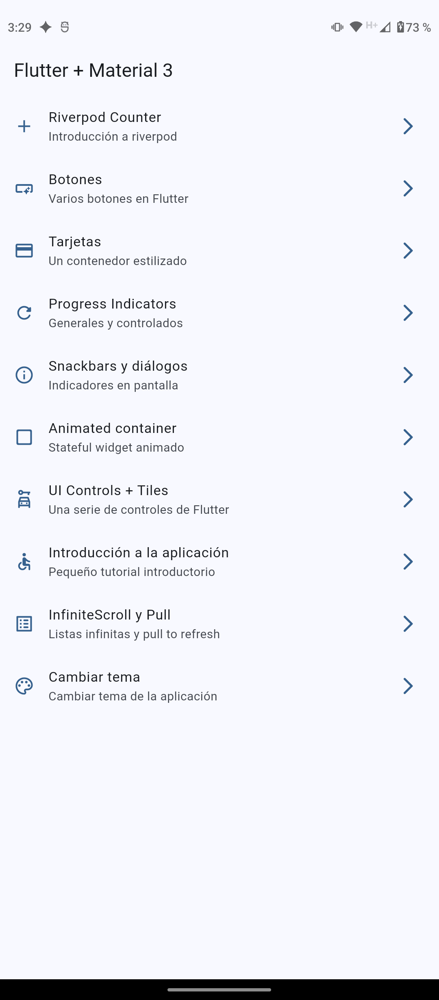<br>Menú principal</td>
		<td align="center">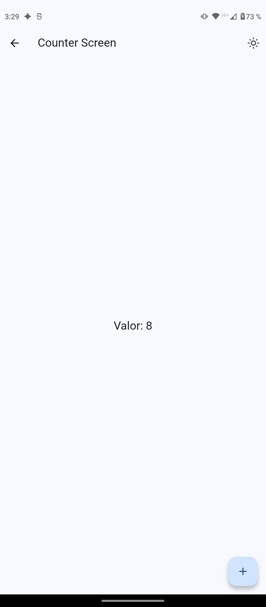<br>Contador</td>
	</tr>
	<tr>
		<td align="center">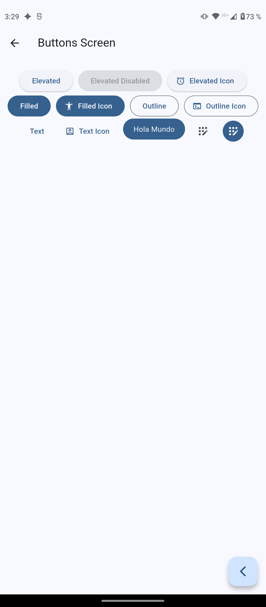<br>Botones</td>
		<td align="center">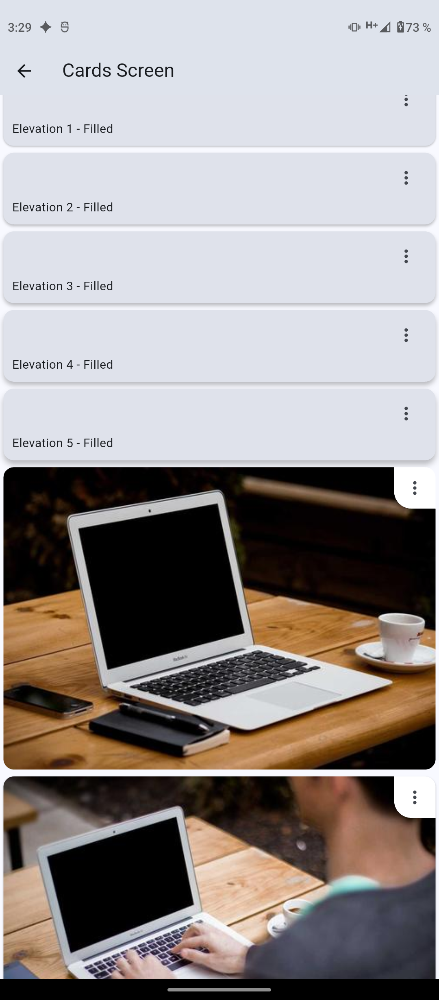<br>Tarjetas</td>
	</tr>
	<tr>
		<td align="center">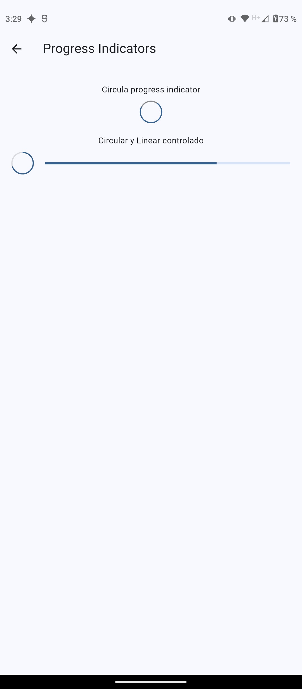<br>Indicadores de progreso</td>
		<td align="center">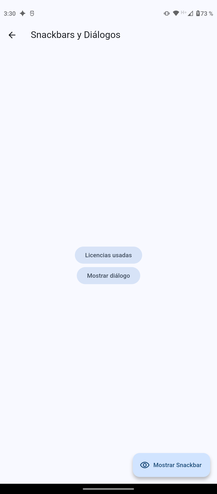<br>Snackbars y diálogos</td>
	</tr>
	<tr>
		<td align="center">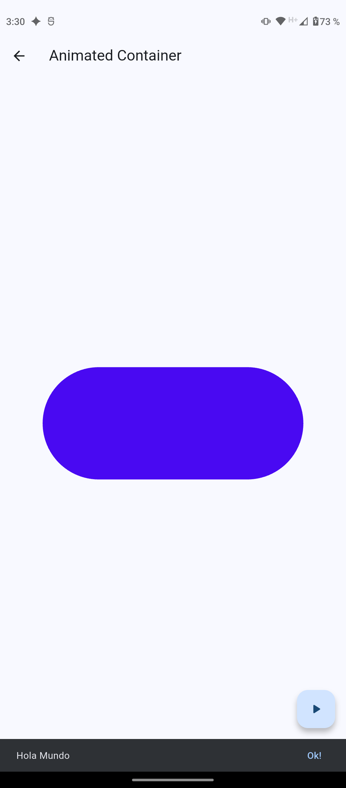<br>Animated Container</td>
		<td align="center">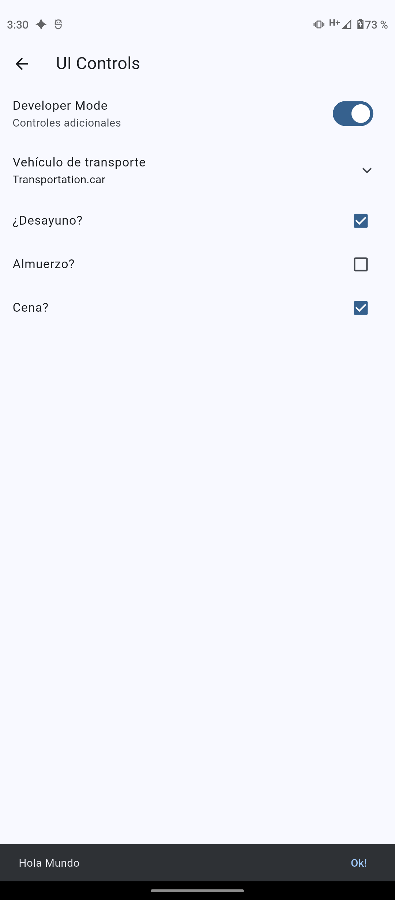<br>Controles de interfaz</td>
	</tr>
	<tr>
		<td align="center">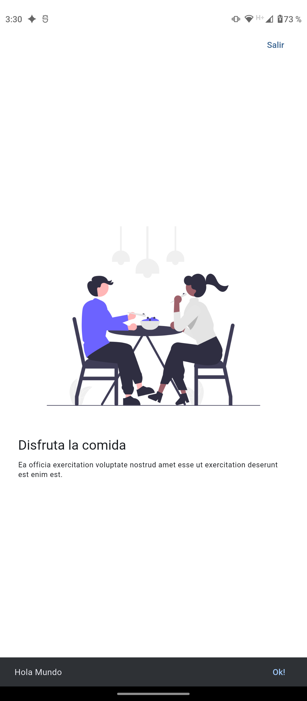<br>Tutorial</td>
		<td align="center">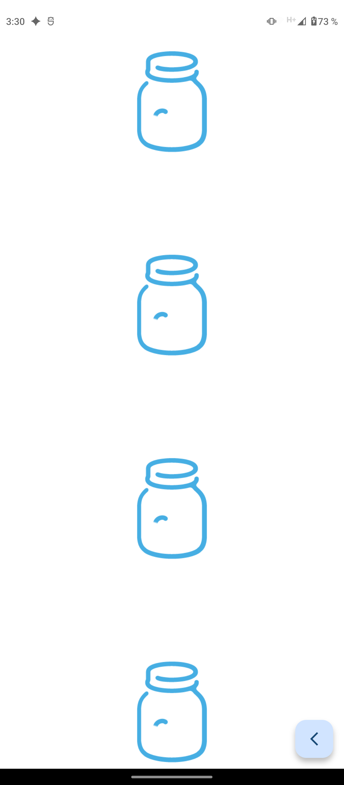<br>Desplazamiento infinito</td>
	</tr>
	<tr>
		<td align="center">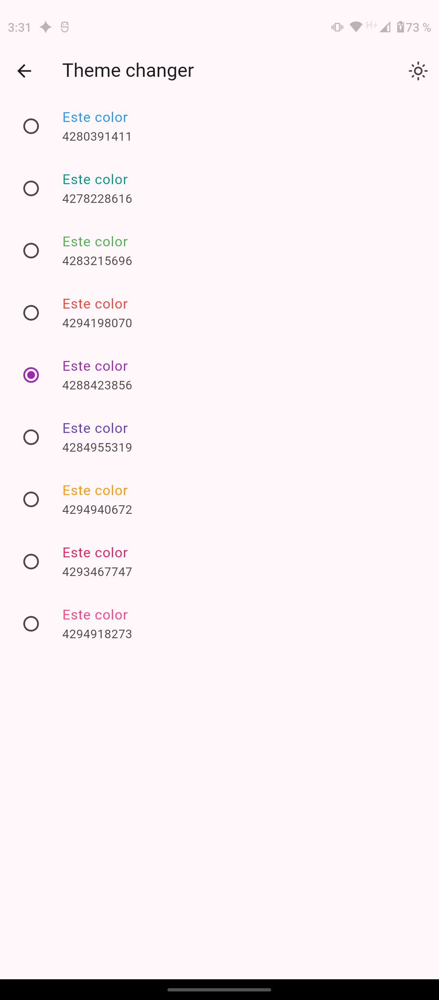<br>Tema morado</td>
		<td align="center">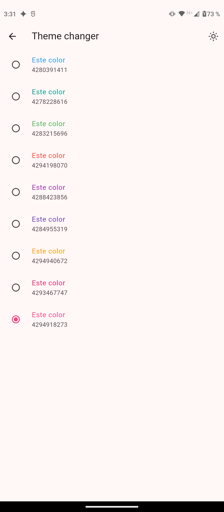<br>Tema naranja</td>
	</tr>
	<tr>
		<td align="center">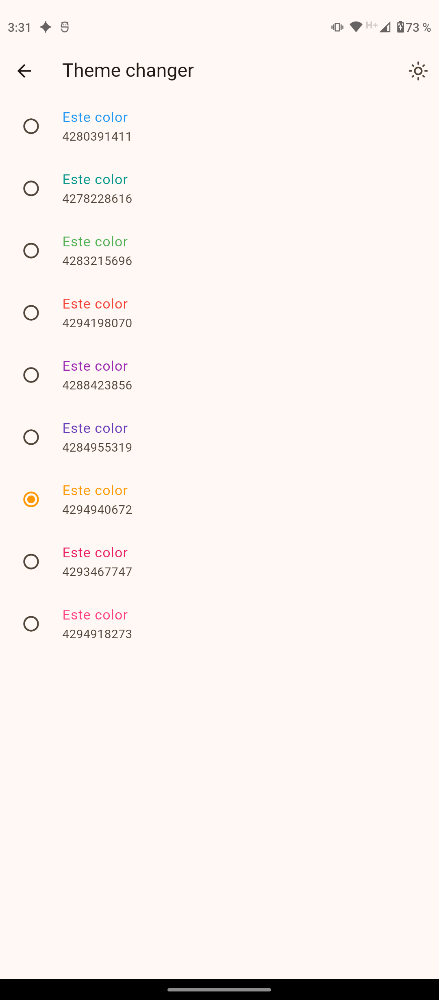<br>Tema rosa</td>
		<td align="center">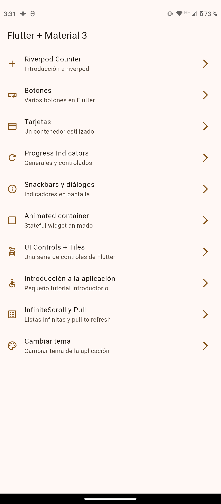<br>Menú con tema café</td>
	</tr>
</table>
