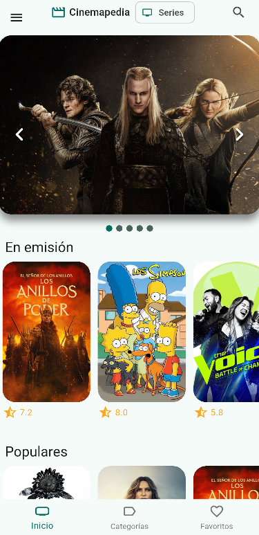
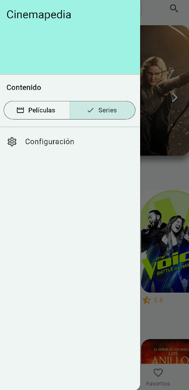
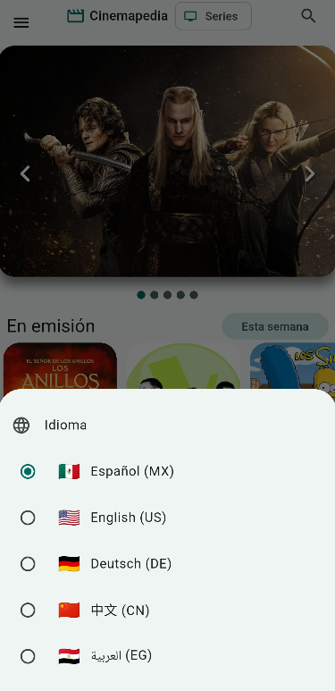
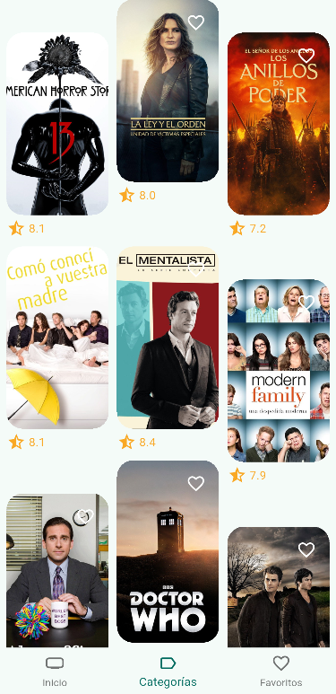
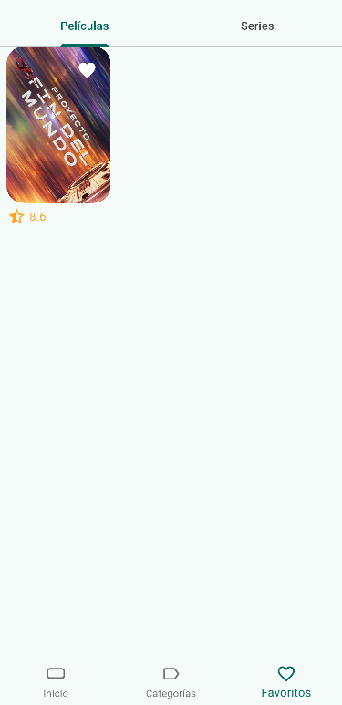
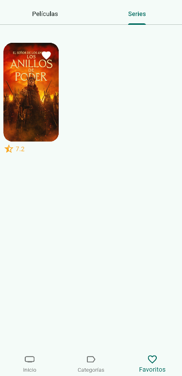
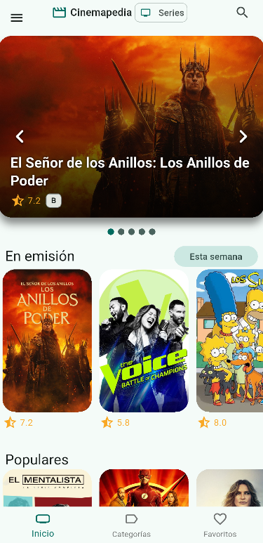
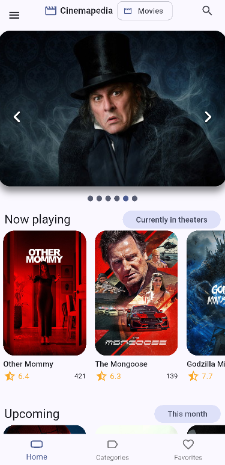
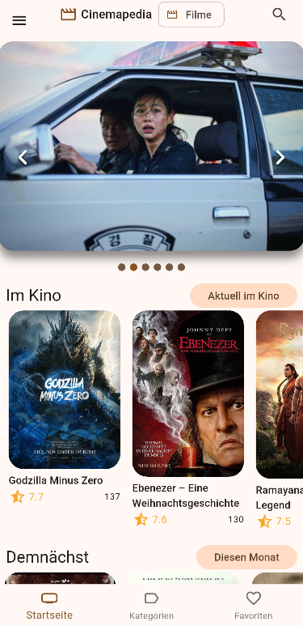
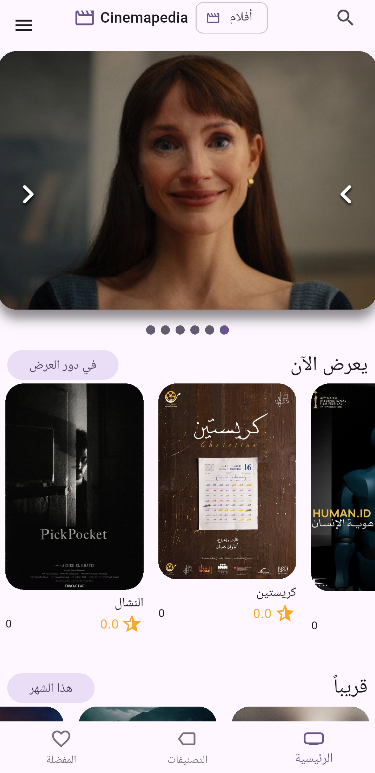

# Práctica No. 6: Cinemapedia

**Aplicación de consulta de películas con Flutter**

## Descripción

Cinemapedia es una aplicación multiplataforma desarrollada con Flutter para
explorar películas y consultar información relacionada mediante la API de
The Movie Database (TMDB). La aplicación muestra películas en cartelera,
próximamente, populares y mejor calificadas, además de permitir buscar títulos,
consultar detalles y visualizar el reparto de cada película.

La aplicación utiliza una arquitectura organizada en capas de presentación,
dominio e infraestructura, con Riverpod para la administración del estado y
GoRouter para la navegación.

## Actividades realizadas

- Creación de una aplicación multiplataforma con Flutter.
- Integración de la API REST de The Movie Database (TMDB).
- Implementación de solicitudes HTTP mediante `Dio`.
- Organización del proyecto con arquitectura CLEAN.
- Creación de entidades y contratos para películas y actores.
- Implementación de repositorios y datasources para películas y reparto.
- Conversión de respuestas de TMDB a entidades de dominio mediante mappers.
- Administración del estado con `flutter_riverpod`.
- Implementación de navegación con `go_router`.
- Creación de una pantalla principal con carruseles de películas.
- Implementación de búsqueda de películas.
- Creación de una pantalla de detalles con sinopsis, géneros y reparto.
- Configuración de idiomas y regiones para las consultas a TMDB.
- Carga de variables de entorno mediante `flutter_dotenv`.

## Objetivos

- Comprender la comunicación entre una aplicación Flutter y una API externa.
- Aplicar separación de responsabilidades mediante arquitectura CLEAN.
- Practicar el uso de providers para administrar datos asíncronos.
- Implementar navegación entre pantallas con parámetros de ruta.
- Trabajar con modelos, entidades, repositorios y fuentes de datos.
- Crear interfaces adaptables para los targets soportados por Flutter.
- Implementar localización para distintos idiomas y regiones.

## Funcionalidades

- **Películas en cartelera:** consulta las películas actualmente disponibles en
  cines.
- **Próximamente:** muestra próximos estrenos.
- **Películas populares:** presenta los títulos con mayor popularidad.
- **Mejor calificadas:** muestra las películas con mejores puntuaciones.
- **Búsqueda:** permite buscar películas por título.
- **Detalles:** muestra título, sinopsis, clasificación, géneros y póster.
- **Reparto:** consulta y muestra los actores asociados a una película.
- **Navegación:** permite acceder a los detalles desde las listas y regresar a
  la pantalla principal.
- **Idiomas:** incluye Español, Inglés, Alemán, Chino y Árabe, con sus regiones
  correspondientes para las consultas a TMDB.
- **Carga progresiva:** muestra indicadores de carga mientras se consultan los
  datos remotos.

## Paquetes principales

| Paquete | Uso |
| --- | --- |
| `flutter_riverpod` | Administración y distribución del estado. |
| `go_router` | Navegación entre pantallas y rutas con parámetros. |
| `dio` | Solicitudes HTTP a la API de TMDB. |
| `flutter_dotenv` | Lectura de variables de entorno. |
| `flutter_localizations` | Localización de widgets y formatos de Flutter. |
| `card_swiper` | Presentación de películas destacadas en carrusel. |
| `animate_do` | Animaciones de elementos de la interfaz. |
| `intl` | Utilidades para formatos y datos localizados. |

## Configuración y ejecución

Instala las dependencias desde la carpeta `practica_06/cinemapedia`:

```shell
flutter pub get
```

Configura la clave de TMDB en un archivo `.env` dentro de la carpeta del
proyecto:

```env
THE_MOVIEDB_KEY=tu_clave_de_tmdb
```

No incluyas claves reales en el código ni en el repositorio. Después ejecuta la
aplicación con:

```shell
flutter run
```

La aplicación puede ejecutarse en los targets de Flutter configurados para el
proyecto:

- Android
- iOS
- Web
- Windows
- macOS
- Linux

## Validación

Desde `practica_06/cinemapedia`, ejecuta:

```shell
flutter analyze
flutter test
```

## Evidencias

### Pantalla principal y navegación

| Inicio (Películas) | Inicio (Series) |
| :---: | :---: |
|  |  |
| Carrusel principal y listados por sección en español. | Vista principal adaptada al catálogo de series de televisión. |

| Menú lateral | Menú de idiomas |
| :---: | :---: |
|  |  |
| Selector entre Películas y Series y acceso rápido a la configuración de idioma. | Selector visual de idioma y región con banderas identificadoras. |

### Categorías y favoritos

| Categorías de películas | Categorías de series |
| :---: | :---: |
|  |  |
| Exploración visual organizada en cuadrícula escalonada. | Exploración por géneros y categorías de series. |

| Favoritos (Películas) | Favoritos (Series) |
| :---: | :---: |
|  |  |
| Listado de películas guardadas localmente por el usuario. | Sección dedicada a las series almacenadas en favoritos. |

### Detalles y clasificación

| Detalle de película | Detalle de serie |
| :---: | :---: |
|  |  |
| Sinopsis, géneros, clasificación y reparto de una película. | Información, temporadas y reparto de una serie. |

| Clasificación de edad | Clasificación desde el inicio |
| :---: | :---: |
|  |  |
| Clasificación de edad mostrada en el detalle de la película. | Clasificación de edad visible desde la pantalla principal. |

### Localización e idiomas (TMDB)

| Inglés (en-US) | Alemán (de-DE) |
| :---: | :---: |
|  |  |
| Interfaz y catálogo localizados para Estados Unidos. | Interfaz y catálogo localizados para Alemania. |

| Chino (zh-CN) | Árabe (ar-EG) |
| :---: | :---: |
|  |  |
| Interfaz y catálogo localizados en chino simplificado. | Interfaz y catálogo localizados en árabe con adaptación de dirección RTL. |

## Arquitectura

- `lib/presentation/`: pantallas, widgets, navegación y providers de estado.
- `lib/domain/`: entidades y contratos de repositorios y datasources.
- `lib/infrastructure/`: modelos de TMDB, mappers, datasources y repositorios.
- `lib/config/`: configuración de idioma, tema, rutas y variables de entorno.
- `assets/`: recursos gráficos de la aplicación.

El flujo principal de datos es:

```text
Pantallas y widgets
        ↓
   Providers
        ↓
   Repositorios
        ↓
    Dio / TMDB
        ↓
  Mappers y entidades
```

## Diagrama de arquitectura

El diagrama incluye los dispositivos y plataformas desde los que puede
ejecutarse Cinemapedia con Flutter, así como la relación entre la presentación,
el dominio, la infraestructura y la API de TMDB.

[Abrir diagrama de arquitectura](https://hesuh05.github.io/Practicas_DMI_230028/practica_06/cinemapedia/infrastructure/cinemapedia-architecture.html)

[Archivo fuente del diagrama](infrastructure/cinemapedia-architecture.json)

## Demo y Descarga

- **Probar en línea (Appetize.io):** [Ejecutar Cinemapedia en el navegador](https://appetize.io/app/b_wzxoicnncomhhuhf3uuber4smq)
- **Descargar APK (Android):** [app-release.apk](https://drive.google.com/file/d/1TnhGx4rSVrDVV4JGl40UZgIJscgJCJLA/view?usp=sharing)